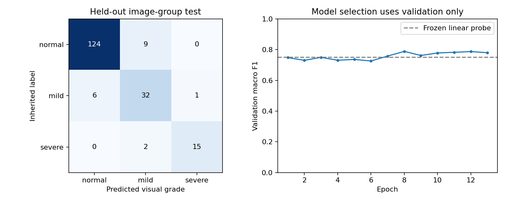

# LSD DataHub audit and visual-grade prototype

Completed on 15 October 2026, Asia/Colombo (14 October UTC). **The isolated prototype is trained and runnable. Proceed with an exploratory visual-grade demonstration; retain veterinary clinical grading and hold application integration pending external validation.** This experiment predicts inherited image labels. It does not validate whole-animal clinical severity, lesion age, treatment decisions, or the application's detector/classifier/segmenter pipeline.

The selected MobileNet V3 Small checkpoint achieved **90.48% accuracy and 0.8775 macro F1** on 189 held-out images. Severe-grade recall was **15/17, or 88.24%**, but these images occupy only ten frozen test bundles. The 95% empirical bundle-bootstrap interval for severe recall spans **64.2% to 100%**. These results support further research, not a clinical accuracy claim.

The source is Francesco Branda's [LumpySkinDisease_DataHub, version 1](https://zenodo.org/records/11003967). The [record API](https://zenodo.org/api/records/11003967) declares CC BY 4.0. We retrieved its unbalanced processed-image archive and two notebooks. The selected 161,418,730-byte nested ZIP passed its outer-member CRC/size check and every nested image CRC; its SHA256 is recorded in [source_provenance.json](artifacts/source_provenance.json). The whole outer ZIP's published MD5 was not verified because the complete outer archive was not downloaded.

All 1,019 files decoded successfully, with no additional clinical records, masks, animal identifiers, farm identifiers, or non-image metadata inside the image archive. All supplied images were already 256 x 256 pixels. This is a processed collection, so the study's description of original-image counts does not establish independent original photographs or recoverable source resolution.

| Inherited label | Supplied images | Retained images | Train images | Validation images | Test images |
| --- | ---: | ---: | ---: | ---: | ---: |
| Normal | 697 | 636 | 377 | 126 | 133 |
| Mild | 231 | 184 | 110 | 35 | 39 |
| Severe | 91 | 73 | 40 | 16 | 17 |
| Total | 1,019 | 893 | 527 | 177 | 189 |

A visual content audit of all thumbnails found cartoons, toys/art, microscope images, vaccine-vial imagery, multi-panel figures, screenshots, news graphics, and large instructional annotations mixed with photographs. Eighty-six files were excluded using the recorded content policy. Matching-source images also appeared under conflicting grade labels: fourteen detected components containing 38 files were excluded rather than arbitrarily relabeled. Two additional exact decoded-pixel duplicates were removed. These categories account for all 126 exclusions. Decisions and file hashes are available in [content_review.json](content_review.json), [audit_summary.json](artifacts/audit_summary.json), [conflicting_groups.json](artifacts/conflicting_groups.json), and [manifest.csv](artifacts/manifest.csv).

For example, versions of the photograph represented by `Normal_Skin_180.png`, `Normal_Skin_489.png`, `Mild_182.png`, `Severe_15.png`, `Severe_21.png`, and `Severe_76.png` carry all three labels. Another group links `Normal_Skin_5.png`, `Normal_Skin_510.png`, and `Severe_11.png`. These are observed source-label conflicts, not a veterinary reassessment of the pictured animals.

Exact RGB hashes, mirrored pHash/dHash comparisons, and manual grouping constraints created 782 conservative split bundles. They were stratified 60/20/20 before training augmentation: 468 train, 157 validation, and 157 test bundles. Stratification operates on bundles, so image percentages differ slightly. No known grouped image crosses partitions. Near-duplicate image detection cannot prove animal/farm independence, particularly for differently cropped or repeated photographs of an animal.

**Grouping correction from final QA:** eight manually entered constraints were broader than confirmed matching-source images. This was an audit error. The affected images share their inherited label and remain jointly within one frozen partition; the error does not create cross-partition leakage. The evaluated manifest, model, and test results were preserved. A corrected source-link review identifies 791 retained image-similarity components, all contained within the existing partition assignments. Accordingly, 782 is the count of conservative split bundles, not a verified count of unique source photographs or animals. [group_review_errata.json](artifacts/group_review_errata.json) lists every correction; [reviewed_group_checks.csv](artifacts/reviewed_group_checks.csv) records the corrected membership checks. The original input file remains frozen for reproducibility. Use the corrected links and a new external test cohort for a later experiment.

The supplied notebooks confirm the filename mapping `Norm -> 0`, `Mild -> 1`, and `Seve -> 2`. Their unbalanced DL recipe resizes RGB images to 128 x 128 and uses an image-level stratified random split, with no animal/source grouping shown. Its preprocessing cell references `df1`, while the inspected preceding cells define `df`; subsequent cells load saved feature arrays. This is not a fully established fresh-run provenance chain. Some ROC/PR cells operate on binarized hard predictions rather than continuous model scores. We inspected notebook JSON only and did not execute notebook cells. [notebook_evidence.json](artifacts/notebook_evidence.json) records hashes and relevant cell indices. We trained our own prespecified baseline rather than treating the notebooks' recorded metrics as reproduced results.

The [associated study](https://doi.org/10.1002/vms3.70664) describes veterinary involvement in image-level annotation. The release does not provide reviewer-by-image grades, disagreements, a reproducible clinical grading rubric tied to each case, or systemic examination data. We inherited filename labels and performed no veterinary regrading. Therefore, the output names mean this dataset's visual categories. Normal does not establish absence of LSD or any other disease.

The frozen [protocol](protocol.json) used an ImageNet-pretrained torchvision MobileNet V3 Small encoder, RGB square padding with gray 114, resizing to 224 x 224, and ImageNet normalization. Training used horizontal flips and small brightness/contrast changes on the training partition only. No random crop was used because cropping can change the visible lesion extent. All release images are already square, so padding does not change their geometry.

We fitted a balanced multinomial logistic regression on frozen encoder features and compared it with a neural head trained for six epochs, followed by limited fine tuning of the last four feature blocks. Fine tuning started from the best validation head checkpoint. Inverse-frequency loss weights came only from training labels; frozen feature blocks retained evaluation-mode BatchNorm. Early stopping used validation macro F1 with validation NLL as a tie-break. It stopped after epoch 13; epoch 8 was selected. The full run took approximately 90 seconds on an RTX 3050 Laptop GPU.

| Candidate / partition | Accuracy | Macro F1 |
| --- | ---: | ---: |
| Frozen-feature logistic regression, validation | 83.05% | 0.7501 |
| Selected neural checkpoint, validation | 85.88% | 0.7883 |
| Selected neural checkpoint, test | 90.48% | 0.8775 |
| Always-normal reference, test | 70.37% | 0.2754 |

Model selection used validation data only. After selection, a scalar temperature of 1.077 was fitted on validation NLL; validation NLL moved from 0.3502 to 0.3493. This small change is not evidence of reliable clinical confidence. The selected model and temperature were fixed before initial test inference. The unused candidate was not compared on test data. No threshold or model was changed in response to test performance.

| Test metric | Result | Empirical 95% bundle-bootstrap interval |
| --- | ---: | ---: |
| Accuracy | 90.48% | 85.71% to 94.86% |
| Macro F1 | 0.8775 | 0.7948 to 0.9384 |
| Balanced accuracy | 87.84% | Not estimated |
| Quadratic weighted kappa | 0.8847 | Not estimated |
| Ordinal mean absolute error | 0.0952 grade steps | 0.0514 to 0.1429 |
| Severe recall | 88.24% | 64.22% to 100% |

Intervals use 1,000 class-stratified resamples of the frozen bundles. They describe uncertainty within this small, inherited-label experiment and its conservative grouping choices; they do not cover hidden same-animal dependence, incorrect clinical labels, source bias, or field-domain shift. Validation severe recall was only 10/16 (62.5%), another indication of small-sample variability. Test performance being higher than validation does not justify replacing the validation selection policy or claiming the same performance in the field.

| Inherited test grade / predicted grade | Normal | Mild | Severe |
| --- | ---: | ---: | ---: |
| Normal | 124 | 9 | 0 |
| Mild | 6 | 32 | 1 |
| Severe | 0 | 2 | 15 |

There were 18 disagreements with inherited labels. Mild-grade precision was 74.42% and recall was 82.05%, making that class the weakest by F1. We reviewed all disagreement thumbnails without changing their labels or refitting the model. The local `artifacts/test_examples.jpg` contains all disagreements, including two severe-labeled images predicted mild. Because labels have not been independently regraded, these remain model/label disagreements rather than confirmed clinical mistakes. The complete predictions are in [test_predictions.csv](artifacts/test_predictions.csv).

The selected [local checkpoint](artifacts/weights/best_model.pt) is 6,209,989 bytes, with SHA256 `787cc93393e166e346bc957306cc099e000dfce72f8521d31b7cf985a308c4ee`. It contains class order, preprocessing metadata, temperature, manifest/protocol hashes, and explicit flags that clinical severity/stage are unsupported. All 189 CPU reload predictions matched their recorded GPU class decisions. CPU/GPU probabilities differed by at most 0.001953; CPU test NLL was 0.2780 versus GPU 0.2781. Three deterministic CLI checks, one per inherited class, verified that clinical severity/stage remain null and veterinary review remains required. [export_verification.json](artifacts/export_verification.json) records these checks. Eight focused research tests passed; the application test suites were not rerun because application code was unchanged.

For a demonstration, run the isolated CLI using the commands in [README.md](README.md), display the three probabilities as model outputs, and present the visual grade beside a separate veterinary clinical assessment. Include failure examples and this held-out table. Do not map the visual grade into the application's clinical severity field, use it to estimate total-body coverage, or apply it to FMD/mastitis. The model has no validated quality/OOD rejection and was evaluated on full processed images, not the current YOLO crops.

The next evidence gate is an independently collected, vet-reviewed cattle-photo cohort with animal/farm IDs and a defined capture protocol. Agree on visual-grade criteria and an unassessable option, capture disagreements, and include look-alike skin conditions and genuine negative cases. Keep clinical illness measurements/grades separate. Freeze that external evaluation before further tuning. Until then, this is a useful research prototype with known data weaknesses, and veterinary clinical grading remains the product's clinical authority.
